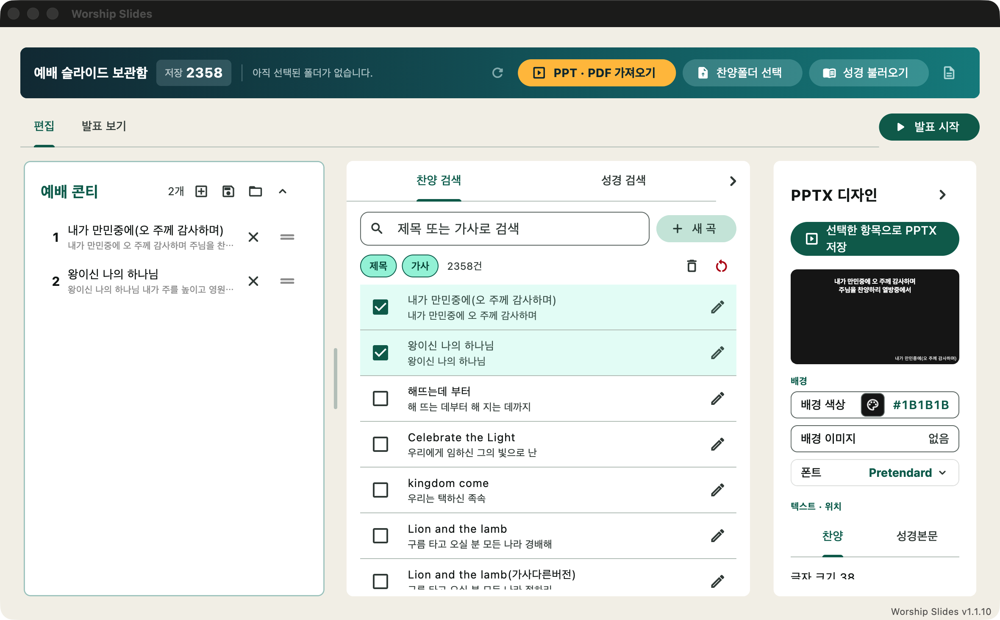
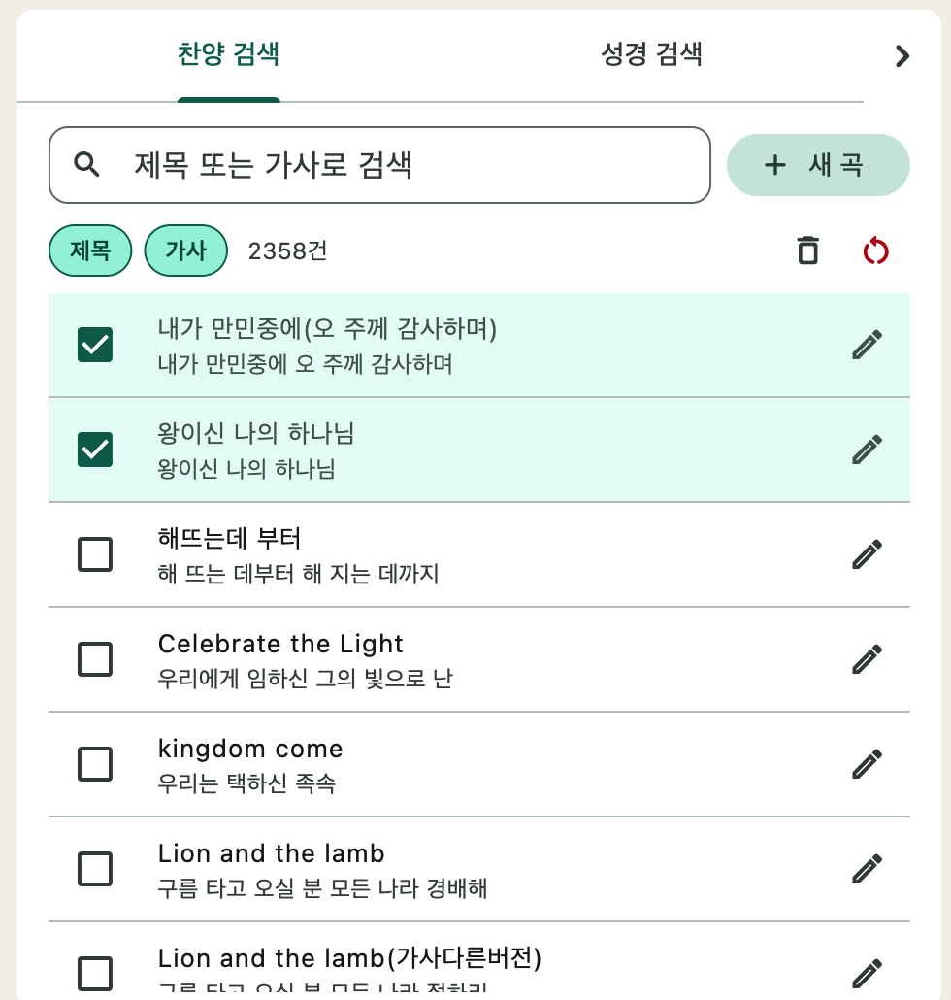
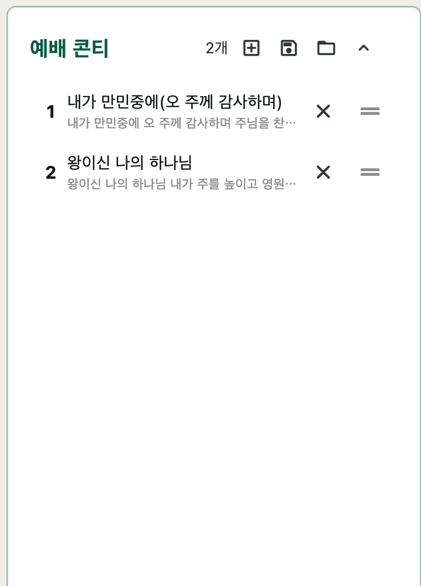
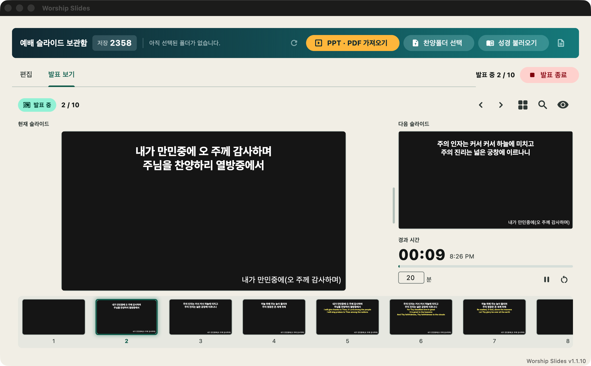

# Worship Slides

예배 찬양 가사·성경 슬라이드를 한 곳에서 준비하고 바로 띄우는 데스크톱 앱 (macOS · Windows).

찬양 PPT 폴더를 통째로 가져와 가사를 DB에 모아 두고, 곡·성경 구절·외부 PPT·동영상을 섞어 콘티를 만든 뒤
보조 모니터에 바로 발표하거나 PPTX 파일로 내보냅니다.



- **다운로드**: [Releases](https://github.com/yjchae/worship_slide/releases) 에서 `worship_slides-macos-*.zip` / `worship_slides-windows-*.zip`
- **사용 설명서**: [docs/user-manual.html](docs/user-manual.html) · [예배슬라이드_사용자설명서.pdf](예배슬라이드_사용자설명서.pdf)
- **개인정보처리방침**: [docs/privacy.md](docs/privacy.md)

## 주요 기능

### 가사·성경 모으기
- **PPT 폴더 일괄 가져오기** — `.ppt` / `.pptx` 를 재귀 탐색해 가사를 SQLite 에 저장. 다시 가져오면 중복은 건너뜀
- **원본·보조 언어 가사 자동 분리** — 한글/영어(일본어·중국어 등) 줄을 나누고, 번역 가사 색(주황 등)까지 보고 판단
- **다국어** — 영어 외의 보조 언어 가사를 곡 제목 기준으로 붙이고, 콘티에 담을 때 언어를 고름
- **악보 가사 추출** — 악보 이미지·PDF·클립보드 그림에서 오선 아래 가사만 읽어 새 곡으로. OS 내장 OCR(macOS Vision · Windows.Media.Ocr) 우선, 없으면 Tesseract. 글자가 박힌 PDF 는 OCR 없이 읽음
- **성경** — 역본별 JSON 을 가져와 `요 3:16` 같은 참조로 찾기. 보조 역본을 함께 표시 가능



### 콘티 만들기
- **곡 / 성경 / 외부 PPT·PDF(페이지 이미지) / 빈 페이지 / 설교 제목 / 동영상·음악·유튜브** 를 끌어서 순서 조정
- **외부 PPT 애니메이션 단계 펼치기** — 클릭 한 번 = 한 페이지로 나눠서 "하나씩 나타나기" 순서를 살림
- **원본 열어 수정** — 외부 PPT 를 PowerPoint 로 열어 고치면 저장을 감지해 자동으로 다시 구움
- **디자인** — 배경 색·이미지, 글꼴(내장 무료 글꼴 포함)·색·크기·정렬·위치를 가사·성경 따로. 실시간 미리보기
- **항목별 배경 · 헌금송 · 배경 영상** — 특정 항목만 다른 배경, 헌금 계좌 띠, 가사 뒤 반복 영상
- **콘티 저장·불러오기 · `.wsconti` 파일로 옮기기** — 저장 시점 가사·이미지까지 함께 보관



### 발표
- **보조 모니터 전체화면 송출** (네이티브 창) — 모니터 선택, 블랙아웃, 영역 확대·포인터, 동영상 재생바
- **발표 보기** — 현재·다음 페이지, 메모, 경과 시간, 곡 찾기(Ctrl/⌘+F), 썸네일 끌어 놓기로 페이지 옮기기·복사·붙여 넣기
- **싱어 화면** — 세 번째 모니터에 현재+다음 가사를 크게
- **휴대폰 싱어 화면 · 발표자 리모컨** — 같은 와이파이에서 QR 로 접속. `cloudflared` 가 있으면 LTE 등 바깥 망 주소도 제공



### 여러 PC 에서 함께 쓰기
- **찬양·콘티 동기화 (구글 드라이브)** — 관리자가 만든 접속 키 하나로 연결, 버튼을 누를 때만 합침. 자세한 준비는 [docs/sync-key-guide.md](docs/sync-key-guide.md)
- **PPTX 내보내기 · 자동 업데이트 확인**

### 발표 단축키

| 키 | 동작 |
|----|------|
| F5 | 발표 시작 |
| → · ↓ · Space | 다음 슬라이드 |
| ← · ↑ | 이전 슬라이드 |
| 숫자 + Enter | 해당 번호 슬라이드로 이동 |
| Ctrl+F4 (macOS 는 ⌘F4 도) | 발표 종료 |
| Ctrl+F (macOS ⌘F) | 곡 찾기 (발표 보기) |
| F3 / F2 | 다음 찾기 / 이전 찾기 |
| ⌘/Ctrl+C · V, Delete | 썸네일 복사 · 붙여 넣기 · 고른 페이지 삭제 |

## 설치 (사용자)

1. [Releases](https://github.com/yjchae/worship_slide/releases) 에서 OS 에 맞는 zip 을 받아 풉니다.
2. **macOS**: 코드 서명이 없어 Gatekeeper 가 막으므로, 폴더 안 `Unlock Worship Slides.command` 를 우클릭 → 열기로 한 번 실행한 뒤 `Worship Slides.app` 을 엽니다.
   **Windows**: `worship_slides.exe` 를 실행합니다.
3. 업데이트는 앱 안 배너로 받습니다. 곡·콘티 DB(`worship_slides.db`)는 앱 폴더 안에 있으니 폴더를 지우지 마세요.

### 선택 프로그램 (없으면 그 기능만 꺼짐. LibreOffice·cloudflared 는 앱 안 '자동 설치' 버튼 제공)

| 프로그램 | 필요한 기능 |
|----------|-------------|
| [LibreOffice](https://www.libreoffice.org/) | `.ppt`(구형) 가져오기, 외부 PPT 를 이미지로 넣기 |
| [Tesseract OCR](https://github.com/tesseract-ocr/tesseract) (+ `kor` 데이터) | OS 내장 OCR 이 안 될 때 악보 가사 읽기 |
| [cloudflared](https://github.com/cloudflare/cloudflared) | 휴대폰 싱어·리모컨의 바깥 망(LTE) 주소 |
| [WebView2 런타임](https://developer.microsoft.com/microsoft-edge/webview2/) (Windows) | 동영상·유튜브·배경 영상 재생 (Windows 10/11 에는 보통 이미 있음) |

## 개발

### 요구사항
- Flutter SDK (Dart `^3.11`), Python 3
- macOS 12 이상 / Windows 10 1803 이상 (악보 OCR 의 Vision 한국어는 macOS 13 이상)

### 실행

```bash
flutter pub get

# Python 도구(PyInstaller) 빌드 — 건너뛰면 가져오기·내보내기·발표가 동작하지 않습니다.
# .venv 생성과 python/requirements.txt 설치까지 스크립트가 처리합니다.
./scripts/build.sh      # macOS
.\scripts\build.ps1     # Windows (PowerShell)

flutter run -d macos    # 또는 flutter run -d windows
```

`python/ppt_tool.py` 를 고치면 빌드 스크립트를 다시 돌려야 반영됩니다.

### 테스트

```bash
flutter analyze
flutter test                          # Dart 단위·위젯 테스트 전체 (test/)
python3 python/test_render.py         # PPT → 이미지 (LibreOffice 없으면 skip)
python3 python/test_animation.py      # 애니메이션 단계 펼치기
python3 python/test_export_background.py
python3 python/test_export_text.py
python3 python/test_export_position.py
python3 python/test_split_language.py
python3 python/test_sheet_lyrics.py   # 악보 가사 (Tesseract 없으면 OCR 부분만 skip)
python3 python/test_media.py
```

Swift(macOS)·C++(Windows) 발표 창 코드는 PR 을 열면 GitHub Actions 가 실제로 빌드해 검증합니다.

### 배포
- `./scripts/build.sh` / `build.ps1` → `dist/worship_slides/` (앱 + `python/ppt_tool/`)
- `v*` 태그를 푸시하면 GitHub Actions 가 macOS/Windows zip 을 만들어 Release 에 올립니다. **태그와 `pubspec.yaml` 의 `version` 이 같아야** 업데이트 확인이 동작합니다.

```bash
git tag v1.2.16
git push origin v1.2.16
```

## 기술 스택

| 영역 | 기술 |
|------|------|
| UI | Flutter Desktop (macOS · Windows) |
| 데이터베이스 | SQLite (`sqflite_common_ffi`) |
| PPT 읽기/쓰기 | Python 3 + `python-pptx` (PyInstaller onedir 로 빌드해 서브프로세스 호출) |
| PPT → 이미지 | LibreOffice(`soffice`) → PDF → PyMuPDF → PNG |
| 악보 가사 | Pillow(오선 찾기) → PDF 글자층(PyMuPDF) / OS 내장 OCR / Tesseract |
| 발표 창 | macOS: WKWebView · Windows: GDI + GDI+ (네이티브 창, MethodChannel 제어) |
| 미디어 재생 | macOS: WKWebView · Windows: WebView2 |
| 동기화 | Google Drive REST API v3 (`drive.file` 권한) |
| 휴대폰 화면 | 앱 내장 HTTP 서버(`dart:io`) + SSE, Cloudflare 임시 터널 |

## 데이터 저장 위치

| 데이터 | 위치 |
|--------|------|
| 곡 · 성경 · 콘티 DB | 실행 파일 옆 `worship_slides.db` (스키마를 올리기 전 `*.v<버전>.bak` 자동 백업) |
| 디자인·헌금송·설교·모니터 설정 | Application Support `/worship_slides/*.json` |
| 동기화 설정·접속 키 | Application Support `/worship_slides/song_sync.json`, `sync_key.txt` |
| 배경 이미지·영상 모음 | Application Support `/worship_slides/offering_images/`, `background_videos/` |
| 외부 PPT 페이지 이미지 | Application Support `/worship_slides/ppt_slides/` |
| 로그 | Application Support `/worship_slides/logs/app.log` (앱 안 '로그 보기') |
| `.ppt` 변환 캐시 | Caches `/worship_slides/ppt_import_cache/` |

## 프로젝트 구조

```
worship_slides/
├── lib/                    # Flutter/Dart 소스 (자세한 구조는 CLAUDE.md)
├── python/ppt_tool.py      # CLI: import | render | export | sheet | sheet-finish
├── macos/, windows/        # 네이티브 발표·싱어 창, 미디어 레이어, OCR 채널
├── assets/fonts/           # Pretendard · 나눔 글꼴 + free/ (OFL 무료 글꼴)
├── scripts/                # 배포 빌드, 동기화 접속 키 만들기(make_sync_key.py)
├── docs/                   # GitHub Pages(홈·개인정보처리방침)·사용 설명서·동기화 안내
├── test/                   # Flutter 테스트
├── CLAUDE.md               # 아키텍처 · 설계 결정 상세
└── THIRD_PARTY_NOTICES.md  # 사용한 오픈소스와 라이선스
```

## 오픈소스

이 앱은 Flutter, python-pptx, PyMuPDF, Pillow, PyInstaller, SQLite 등 여러 오픈소스와
Pretendard · 나눔 · Google Fonts(OFL) 글꼴을 사용합니다. 전체 목록과 라이선스는
[THIRD_PARTY_NOTICES.md](THIRD_PARTY_NOTICES.md) 에 있습니다.
