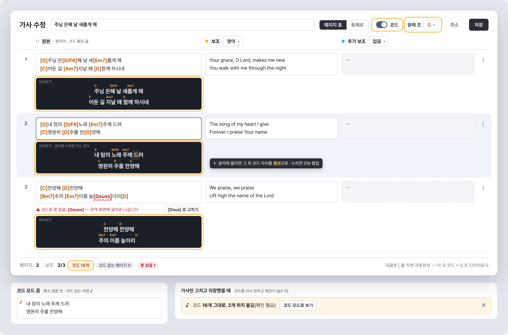
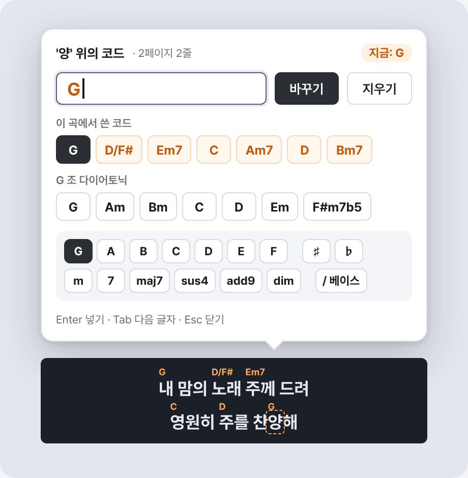
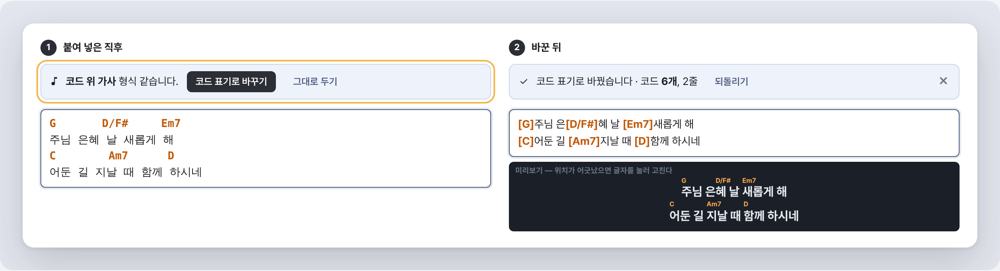
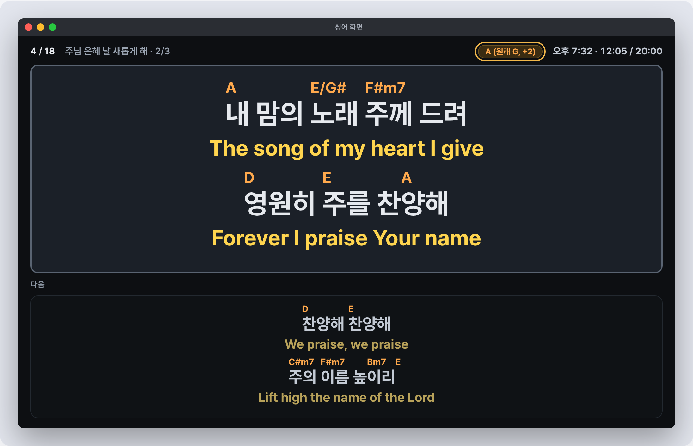
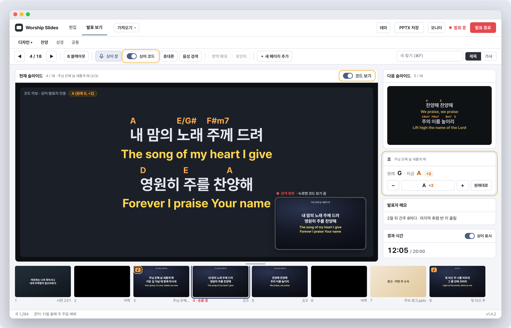
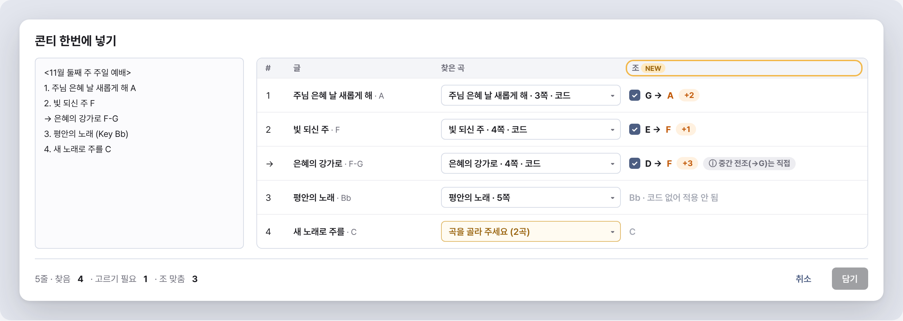
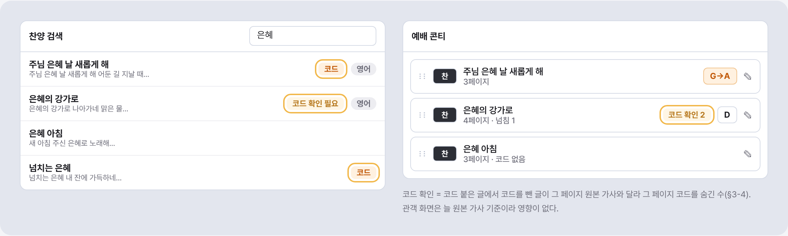

# 기획서 — 찬양 가사에 코드 넣기 (싱어·발표자 화면 전용)

- 작성일: 2026-11-06
- 상태: **기획(사용자 확인 전)** — 앱 코드는 아직 손대지 않았다
- 화면 목업: `screens/s1.png` ~ `screens/s7.png` (UI 설계자가 만든다)
- 요청 원문: "찬양 가사 넣을 때 코드도 가사 위치에 넣을 수 있게 하고, 그걸 싱어 화면이나 발표자 화면에서도 볼 수 있게 하고 싶어"

---

## 0. 한눈에 보기

| 항목 | 내용 |
|---|---|
| 목표 | 원본 가사의 음절 위에 기타·건반 코드(C, G7, Am/E …)를 얹은 **코드 악보**를 만들고, 발표 중 싱어·발표자 화면에서 켜고 끈다 |
| 편집 표기 | ChordPro 인라인 `[G]주 은[D/F#]혜` — 코드는 **바로 뒤 글자 위**에 뜬다 |
| 저장 | `praise_songs.lyrics`(원본 가사)는 그대로. **코드 붙은 원본 가사를 새 칸** `praise_songs.chord_lyrics` 에 둔다(DB version 20) |
| 진실의 원천 | **원본 가사(`lyrics`)가 기준.** 코드 칸에서 코드를 지운 글이 원본 가사와 다르면 자동으로 다시 맞추고(§3-5), 그래도 안 맞는 페이지는 코드를 안 보인다 |
| 보이는 곳 | 네이티브 싱어 창(macOS·Windows) · 휴대폰 싱어/리모컨 · 앱 발표 보기(발표자 화면). **화면마다 켜기/끄기, 기본은 끔** |
| 안 보이는 곳 | 관객 화면(미리보기·macOS·Windows 발표 창) · PPTX · 통역 화면(B) · 배경 영상 가사 PNG · 썸네일 — **어떤 설정으로도 안 나간다** |
| 언어 | 원본 언어 줄에만. 보조·추가 보조 가사엔 코드 없음 |
| 편집 화면 | 가사 수정 창(페이지 표)의 **'코드' 모드**: 원본 열이 코드 붙은 글이 되고, 칸 아래에 코드 악보 미리보기. 글자 클릭 → 코드 넣기 팝업 보조 |
| 조 바꾸기 | **1차에 포함.** 콘티 항목마다 ±반음(곡 DB 는 그대로). 콘티 한번에 넣기가 읽은 조(F, Bb)로 자동 설정 |
| 동기화·저장 | 찬양 동기화 파일 `chord_lyrics` 키, 콘티 스냅샷 `song_chord_lyrics`·`chord_transpose`, `.wsconti`·클라우드 콘티 자동 포함 |
| 2차 | 악보 OCR 코드 살리기, ChordPro 파일(.cho) 가져오기, 관객용 코드 악보 PPTX, 카포 표시 등(§4) |

### 사용자 확인이 필요한 결정 (★ = 추천안)

| # | 결정 | 선택지 | 추천 |
|---|---|---|---|
| D1 | 코드 저장 위치 | ★A. `praise_songs.chord_lyrics` 새 칸(곡 uid 마다) / B. `song_translations` 에 '코드'라는 언어로 | **A.** B 는 동기화 코드를 안 고쳐도 되지만 옛 버전 앱의 언어 드롭다운에 '코드'가 떠서 **관객 화면 보조 언어로 고를 수 있다**(대괄호째 관객에게 나감). 또 키가 제목이라 같은 제목 다른 곡(편곡)이 코드를 같이 쓴다 |
| D2 | 코드와 가사가 어긋났을 때 | ★A. 저장할 때 자동으로 다시 맞추고(글자 정렬), 남은 어긋남은 그 페이지만 코드 숨김 + '코드 확인 필요' 표시 / B. 어긋나면 곡 전체 코드 숨김 / C. 코드 칸을 기준으로 원본 가사를 덮어씀 | **A.** C 는 관객 화면 가사가 몰래 바뀔 수 있어 위험 |
| D3 | 입력 방법 | ★A. 인라인 타이핑 기본 + 글자 클릭 팝업 + '코드 위 가사' 붙여 넣기 변환 / B. 인라인만 / C. 클릭만 | **A.** §2-S1 비교표 참고 |
| D4 | 발표 보기(발표자 화면)에서 코드를 보이는 방식 | ★A. '코드' 켜면 현재 슬라이드 칸이 **코드 악보 보기**(싱어식 배치)로 바뀌고 관객 화면은 구석 작은 그림으로 / B. 관객 화면 미리보기 위에 코드를 덧그림 | **A.** B 는 디자인 줄 간격(1.25)에 코드 줄이 들어갈 자리가 없어 윗줄 가사를 덮고, 영역 확대 좌표가 관객 화면과 같아야 한다는 규칙과 부딪힌다 |
| D5 | 켜기/끄기 단위·기본값 | ★화면마다 따로, 기본 끔(싱어 창 = 발표 보기 툴바 스위치, 휴대폰 = 기기마다 머리줄 버튼, 발표 보기 = 자기 스위치) / 전체 한 스위치 | **화면마다.** 보컬은 코드가 거슬리고 반주자는 필요하다 |
| D6 | 조 바꾸기를 1차에 넣나 | ★넣는다(콘티 항목 ±반음 + 콘티 한번에 넣기 조 자동 맞춤) / 2차 | **1차.** 콘티 글에 이미 조가 적혀 오고, 곡 DB 는 원래 조 하나뿐이라 조 바꾸기 없이는 매주 코드를 다시 쳐야 한다 |
| D7 | 원래 조를 어떻게 아나 | ★A. 첫 코드로 추정 + 가사 수정 창에서 '원래 조' 고르면 `{key: G}` 지시문으로 저장 / B. 추정만 | **A.** 첫 코드가 IV·V 로 시작하는 곡이 있다 |
| D8 | 코드만 있는 줄(전주·간주 `[C] [G] [Am]`) | ★한 페이지 안의 코드 전용 줄은 허용(싱어·발표자 화면에만 보이는 줄) / 코드 전용 **페이지**는 2차 | 1차 허용(줄), 페이지는 2차 |
| D9 | 휴대폰 화면 '원본만' 규칙과의 관계 | ★코드는 원본 줄에 붙으므로 휴대폰 싱어·리모컨에도 보낸다(보조 가사는 계속 뺌) | 보낸다 |

---

## 1. 사용자 흐름

### 1-1. 코드 넣기 (평일, 찬양 담당)
1. 검색 결과에서 곡을 고르고 '가사 수정' → 가사 수정 창(페이지 표).
2. 머리줄 보기 토글 `페이지 표 | 통째로` 옆 **`코드` 스위치**를 켠다 → 원본 열 칸 글이 `[G]주 은[D]혜` 꼴로 바뀌고 칸 아래에 코드 악보 미리보기가 뜬다.
3. 넣는 방법 셋 중 편한 것:
   - 칸에 직접 `[G]` 를 친다(대괄호를 치면 자동완성 목록 — 이 곡에 이미 쓴 코드 + 원래 조의 다이어토닉 코드).
   - 미리보기의 글자를 클릭 → 코드 팝업에서 고르거나 친다(그 글자 앞에 `[..]` 가 들어간다). 이미 있는 코드를 클릭하면 바꾸기·지우기.
   - 인터넷·카톡의 **"코드 줄 + 가사 줄"** 악보를 붙여 넣으면 "코드 위 가사 형식을 코드 표기로 바꿀까요?" 배너 → 바꾸기.
4. 머리줄 '원래 조 [G▼]'(첫 코드로 추정해 미리 채움)를 확인한다.
5. 저장. 코드를 못 읽은 대괄호(`[Gsuss]`)가 있으면 저장 전 경고 — "관객 화면에 글자로 나갑니다".
6. 검색 결과 줄에 `코드` 배지가 붙는다. '동기화 안 한 찬양 있음'이 뜨고, 찬양 동기화를 누르면 다른 PC 로 간다.

### 1-2. 콘티 담기
1. 평소처럼 더블클릭·담기·콘티 한번에 넣기. 담는 순간 코드 붙은 가사도 스냅샷으로 들어간다(`_withSubLyrics` 와 같은 자리).
2. 콘티 항목 줄에 조 칩 `G` 이 보인다. 칩을 눌러 `−`/`+` 로 반음씩 → `G → A (+2)`.
3. 콘티 한번에 넣기에서 `3. 주 은혜 A` 처럼 조가 적혀 있고 곡에 코드·원래 조가 있으면 그 조로 자동 설정(확인 표에 `G → A` 표시).
4. 콘티 저장 → 코드 스냅샷과 조 바꾸기 값이 같이 저장된다. 나중에 라이브러리 곡의 코드를 고쳐도 콘티는 그대로(가사 스냅샷과 같은 규칙, '콘티도 바꿀까요' 질문에 코드도 포함).

### 1-3. 발표 중 보기
1. 발표 시작 → 발표 보기 툴바 마이크 버튼으로 싱어 창을 연다. 툴바의 **'싱어 코드' 스위치**를 켜면 싱어 창의 원본 줄 위에 코드가 뜬다.
2. 반주자는 휴대폰 QR(싱어 키)로 들어가 머리줄 **`코드`** 버튼을 켠다(이 휴대폰만, 기억됨). 인도자 리모컨도 같은 버튼.
3. 발표자(앱 조작자)는 발표 보기 오른쪽 위 **`코드 보기`** 스위치로 현재 슬라이드 칸을 코드 악보로 바꿔 본다. 관객 화면은 구석 작은 그림으로 계속 보인다.
4. 관객 화면·PPTX 는 아무 변화가 없다.

### 1-4. 현장에서 조 바꾸기
1. 리허설에서 "한 키 내려 주세요" → 발표 보기 옆 칸의 현재 항목 조 칩 `−` 를 누른다.
2. 싱어 창·휴대폰·발표 보기 코드가 바로 바뀐다(관객 화면은 다시 그리지 않는다). 콘티를 저장하면 남는다.

---

## 2. 화면 목록

### S1. 가사 수정 창 — 코드 모드


- **머리줄**: 곡 제목 · 보기 `페이지 표 | 통째로` · **`코드` 스위치** · **`원래 조 [G▼]`**(코드 모드일 때만, 12개 장조 + 단조 12개, '모름') · 저장/취소
- **원본 열(코드 모드)**: 칸 글이 코드 붙은 글. 코드 토큰은 입력칸 안에서 색(주황, 굵게)으로 칠한다. 못 읽은 대괄호는 빨간 물결 밑줄 + 칸 아래 `코드로 못 읽음: [Gsuss]`
- **칸 아래 미리보기 띠**(원본 칸마다): 싱어 화면 모양 그대로(코드 줄 + 가사 줄, 어두운 바탕 작은 크기). 글자에 마우스를 올리면 그 글자 위 자리가 점선으로 강조되고, 클릭하면 S1b 팝업
- **보조·추가 보조 열**: 그대로(코드 없음). 코드 모드에서도 옮기기·붙여 넣기 된다
- **칸 도구·행 메뉴**: 지금과 같다(위로 당기기·아래로 밀기·합치기·나누기·복사/붙여 넣기). 코드 모드에선 원본 열이 코드 붙은 글이므로 코드가 같이 움직인다(§3-6)
- **아래 요약 줄**: 기존 요약 + `코드 32개 · 코드 없는 페이지 2 · 못 읽음 1`
- **코드 모드를 껐을 때**(평소 모드): 원본 칸에 코드 없는 가사. 곡에 코드가 있으면 칸 왼쪽 위 작은 `♪` 표시. 여기서 가사를 고치면 저장할 때 코드를 다시 맞추고(§3-5) 결과를 배너로 알린다 — `코드 30개 그대로, 2개 위치 옮김(확인 필요)` + [코드 모드로 보기]
- **통째로 보기**: 코드 모드면 큰 입력칸 하나가 코드 붙은 원본 글이다(붙여 넣기용)

**입력 방법 비교 (D3)**

| | 인라인 타이핑 `[G]` | 글자 클릭 → 팝업 | '코드 위 가사' 붙여 넣기 변환 |
|---|---|---|---|
| 빠르기 | 키보드 익숙하면 가장 빠름 | 코드 하나에 클릭 2~3번 | 이미 있는 악보면 한 번에 |
| 배우기 | 대괄호 규칙을 알아야 함 | 쉬움 | 쉬움 |
| 위치 정확도 | 정확(글자 단위) | 정확 | 고정폭 글꼴 가정이라 한글 폭에서 어긋날 수 있음 → 미리보기로 확인 |
| 구현 | 입력칸 + 색칠 + 자동완성 | 미리보기 글자 좌표 → 글 오프셋 매핑 | 줄 쌍 감지 + 열 위치 → 글자 위치 |
| 판단 | **기본** | **보조(1차)** — 대괄호를 모르는 사용자용 | **1차**(작음). 한글은 폭 2칸으로 센다 |

### S1b. 코드 넣기 팝업 (글자 클릭)


- 클릭한 글자 위에 뜨는 작은 팝업: 입력칸(`G`) + 빠른 버튼 줄(이 곡에서 쓴 코드 순) + 원래 조 다이어토닉 7개(G 조: G Am Bm C D Em F#m7b5)
- 뿌리음 `C D E F G A B` + `♯ ♭` + 성질 `m 7 maj7 sus4 add9 dim` + `/베이스` 조립 버튼(작게)
- 이미 코드가 있으면 [바꾸기] [지우기]. Enter = 넣기, Esc = 닫기, Tab = 다음 글자로 옮겨 계속 넣기

### S1c. '코드 위 가사' 붙여 넣기 배너


- 원본 칸(코드 모드)에 붙여 넣은 글에 "코드만 있는 줄 바로 아래 가사 줄"이 2쌍 이상이면: `코드 위 가사 형식 같습니다. [코드 표기로 바꾸기] [그대로 두기]`
- 바꾸면 미리보기에 결과, 되돌리기 배너(기존 붙여 넣기 나누기 배너와 같은 모양)

### S2. 싱어 창 (네이티브 macOS·Windows)


- 지금 배치 그대로: 머리줄(제목 · 시계 · 쪽 번호) + 현재 페이지(63%) + 다음 페이지(37%)
- 코드가 켜져 있고 그 페이지에 맞는 코드가 있으면 **원본 줄마다 위에 코드 줄**. 코드 = 가사 글자의 0.55배, 굵게, 주황(`#FFC857`, 관객 보조 색과 겹치지 않는 색). 보조 줄은 지금처럼 그 아래(코드 없음)
- 코드 글자가 아래 가사보다 길면 가사 사이를 벌린다(코드끼리 겹치지 않게, 코드 뒤 최소 틈 = 코드 글자 0.4em)
- 머리줄에 작은 조 표시 `A (원래 G, +2)` — 조를 바꿨을 때만
- 코드 없는 페이지·어긋난 페이지는 지금과 똑같이(코드 줄 자리도 안 둔다)
- 창 자체엔 버튼이 없다 — 켜기/끄기는 발표 보기 툴바 '싱어 코드' 스위치(S4). (2차 후보: 싱어 창에서 `C` 키)

### S3. 휴대폰 싱어 / 발표자 리모컨


- 머리줄 '좌우/위아래' 버튼 옆 **`코드`** 버튼(켜짐 = 채운 모양). 이 휴대폰 `localStorage`(`singer_chords`)에 기억, 기본 끔. 콘티에 코드 있는 곡이 하나도 없으면 버튼을 흐리게
- 그리는 규칙은 S2 와 같다(같은 JSON). 다음 페이지 칸도 코드 포함, 0.75배 상한 그대로
- 리모컨: 확대 제스처는 지금처럼 16:9 틀 좌표. 코드가 켜져 있으면 휴대폰 배치가 실제 슬라이드와 더 달라지므로 확대 중에는 '코드 때문에 위치가 다를 수 있음' 안내를 한 번 띄운다(또는 확대 중 코드 자동 숨김 — 구현 때 정함)
- 시계·메시지·메모 띠는 그대로

### S4. 발표 보기 (발표자 화면)


- **툴바**: 마이크(싱어 창) 버튼 옆 **`싱어 코드`** 스위치(네이티브 싱어 창용, 싱어 창이 닫혀 있어도 미리 켤 수 있다)
- **현재 슬라이드 칸 머리**: **`코드 보기`** 스위치. 켜면 칸 안이 코드 악보 보기(S2 와 같은 어두운 배치: 현재 페이지 크게 + 원본 줄 위 코드 + 보조 줄). 칸 오른쪽 아래 구석에 관객 화면 작은 그림(폭 25%, 클릭 = 코드 보기 끄기)
  - 코드 보기 중에는 영역 확대·포인터 도구를 흐리게(관객 화면 좌표와 다르므로)
  - 코드 없는 페이지(성경·PPT·빈 페이지)는 코드 보기를 켜 둬도 평소 슬라이드를 보여 준다
- **오른쪽 칸 '다음 슬라이드'**: 코드 보기가 켜져 있으면 다음 페이지도 코드 악보로
- **오른쪽 칸 새 묶음 '조'**(현재 항목이 코드 있는 곡일 때만): `원래 G · 지금 A (+2)` `[−] [+] [원래대로]` — S5 와 같은 값
- 썸네일 줄·모든 페이지 격자: 코드 안 그림(관객 기준). 코드 있는 곡 항목 첫 썸네일에 작은 `♪` 배지

### S5. 콘티 항목 조 바꾸기 (편집 탭 콘티 목록)


- 코드 있는 곡 항목 줄에 조 칩: 원래대로면 `G`, 바꿨으면 강조색 `G→A`
- 칩 클릭 → 작은 팝오버:
  - `원래 조  G` (추정이면 `G (추정)` + [가사 수정에서 정하기])
  - `−` `[ A  +2 ]` `+` (−11 ~ +11, 12 는 0 으로 돈다)
  - 결과 조 빠른 고르기 12칸(C C#/Db D …) — 누르면 그 조로
  - `♯/♭ 표기`: 자동(조에 맞춤) / ♯ / ♭
  - 첫 페이지 미리보기 한 줄(바뀐 코드)
  - [원래대로]
- 같은 곡 항목이 둘이면(n/m) 따로 바꾼다. 나눈 곡(앞·뒤 조각)은 나눌 때 값을 둘 다 이어받고 이후 따로

### S6. 콘티 한번에 넣기 — 조 표시 (기존 창에 한 칸)


- 줄마다 찾은 곡 옆에 조 칸: 글에 조가 있고 곡에 코드·원래 조가 있으면 `G → F (−2)` 체크(기본 켬). 곡에 코드가 없으면 조는 회색 글자로만(`F`, 적용 안 됨)
- `F-G` 처럼 조가 둘이면 첫 조로 맞추고 `(중간 전조는 직접)` 툴팁

### S7. 곡 목록·콘티 목록 표시 (작은 변경)


- 검색 결과 곡 줄: `코드` 배지(코드 있는 곡). '코드 확인 필요' 곡은 주황 배지
- 콘티 항목: 조 칩(S5) + 어긋난 페이지가 있으면 `코드 확인 N`

---

## 3. 데이터 규칙

### 3-1. 표기 문법

```
코드 토큰  = '[' 코드 ']'
코드       = 뿌리음 변화표? 성질? 텐션* ('/' 뿌리음 변화표?)?   |  'N.C.'
뿌리음     = A B C D E F G            (대문자만)
변화표     = # b ♯ ♭
성질       = m | min | maj | M | dim | aug | sus | sus2 | sus4 | add | ° | ø | +
텐션       = 숫자(2~13) | '(' ... ')' | b5 #5 b9 #9 #11 b13
지시문 줄  = '{key: G}'                 (원래 조, 곡 글 맨 앞 한 줄, 1차는 key 만)
```
- 예: `[G]주 은[D/F#]혜 [Em7]아니면 [C]나 [Dsus4]서 [D]리`
- Python `_CHORD_TOKEN_RE`(악보 OCR)와 같은 뿌리를 쓰되 Dart 쪽 하나(`chord_lyrics.dart`)를 기준으로 하고, 2차 OCR 연결 때 맞춘다
- 코드는 **토큰 바로 뒤 글자 위**. 뒤에 글자가 없으면(줄 끝 `주님[G]`) 그 줄 끝 오른쪽에 뜬다
- 공백 앞 코드(`[G] 주`)는 공백 위(= 앞 낱말과 사이)에 뜬다

### 3-2. 잘못된 표기
| 경우 | 처리 |
|---|---|
| 대괄호 안이 코드 문법이 아님(`[후렴]`, `[Gsuss]`, `[g]`) | **코드가 아니라 가사 글자**로 본다 → 원본 가사에도 그대로 남는다(관객 화면에 나감). 편집 창 빨간 밑줄 + 저장 전 경고. `[g]` 처럼 대문자로 고치면 되는 것은 '고치기' 제안 |
| 짝 없는 `[` / `]` | 글자로 본다(같은 경고) |
| `[[G]]` 등 겹침 | 바깥은 글자, 안쪽 `[G]` 만 코드 → 경고 |
| 연달아 코드 `[G][D]주` | 둘 다 같은 글자 위에 나란히(`G D`) |
| 지시문 줄이 맨 앞이 아니거나 모르는 지시문 `{title: ..}` | 1차는 글자로 보고 경고 |

※ 기존 가사에 `[후렴]` 같은 대괄호가 얼마나 있는지는 **미확인** — 실제 DB 로 세어 보고(1단계) 자주 있으면 코드 문법을 더 엄하게 둔다.

### 3-3. 저장 모양

| 대상 | 칸 | 비고 |
|---|---|---|
| 곡 | `praise_songs.chord_lyrics TEXT NOT NULL DEFAULT ''` | 코드 붙은 **원본 가사 전체**(페이지 구분 빈 줄 그대로) + 맨 앞 `{key: ..}` 지시문 선택. 빈 문자열 = 코드 없음 |
| 곡 모델 | `PraiseSong.chordLyrics` | `toMap` 포함. `LyricsPage` 에 `chords`(그 페이지 코드 붙은 글, 없으면 '') 추가 → 나누기·복사·옮기기가 따라간다 |
| 콘티 항목 | `worship_conti_items.song_chord_lyrics TEXT`, `chord_transpose INTEGER` | 담을 때 스냅샷. 조 바꾸기는 −11~11 |
| 콘티 모델 | `SongStagingItem.chordTranspose`(+ 표기 ♯/♭ 선호) | 곡 안의 `chordLyrics` 는 스냅샷 |
| 동기화 | `SyncSong.chordLyrics` → JSON `chord_lyrics` | §3-7 |
| 싱어 JSON | `SingerPage.chordLines` → `chords` | 아래 |
| DB | **version 19 → 20**, 올리기 전 자동 백업(`worship_slides.db.v19.bak`) 그대로 | |

싱어 JSON(코드 칸만 새로, 네이티브가 ChordPro 를 풀지 않게 **Dart 가 풀고 조를 바꿔 보낸다**):
```json
"current": {
  "main_text": "주 은혜 아니면\n나 서지 못하리",
  "chords": [
    [{"c":"G","t":"주 은"},{"c":"D/F#","t":"혜 "},{"c":"Em7","t":"아니면"}],
    [{"c":"C","t":"나 "},{"c":"Dsus4","t":"서지 "},{"c":"D","t":"못하리"}]
  ],
  "show_chords": true,
  "key_label": "A (원래 G, +2)"
}
```
- `chords` 줄 수 = `main_text` 줄 수(+ 코드 전용 줄은 `t` 가 빈 조각뿐인 줄로 끼운다 → 이때만 줄 수가 다르다). 코드 없는 페이지는 `chords` 를 안 싣는다
- 코드 앞 글자(첫 조각 `c` 가 빈 문자열)도 조각으로 나눈다
- `show_chords` 는 네이티브 싱어 창용(발표 보기 '싱어 코드' 스위치). 휴대폰은 이 값을 무시하고 자기 버튼을 따른다
- 원본 줄을 그대로 쓰는 규칙(자동 줄바꿈 없음)은 유지. `main_text` 는 지금과 같아서 코드를 모르는 옛 페이지도 그대로 보인다

### 3-4. 코드 빼기 = 원본 가사 (정합 판정)
- `stripChords(chordLyrics)` = 지시문 줄 빼기 → 코드 토큰 빼기 → **코드가 있었는데 빈칸만 남은 줄은 통째로 뺀다**(코드 전용 줄) → 줄 끝 공백 정리
- 곡 단위: `normalize(stripChords(chord)) == normalize(lyrics)` 면 정상. `normalize` = 줄 끝 공백·`\r` 정리, 페이지 구분 `normalizeEditableLyrics` 와 같게
- **페이지 단위**(표시 직전 마지막 안전장치): 콘티 항목의 페이지 i 의 코드 글을 빼서 그 페이지 원본과 같을 때만 그 페이지 코드를 보인다. 다르면 그 페이지는 코드 없이 + 편집 창·콘티 항목에 '코드 확인 N'

### 3-5. 코드와 가사가 어긋났을 때 — 다시 맞추기
누가 가사만 고치면(평소 모드 가사 수정, 곡 편집, 한 장 고치기 `_SlideQuickEditDialog`, 폴더 다시 가져오기로 기존 곡 고치기, 옛 버전 PC 에서 고친 곡 동기화) 코드 칸이 옛 가사를 붙잡고 있게 된다. 처리:

1. **`realignChords(oldChordLyrics, newLyrics)`** 순수 함수 하나: 옛 코드 글에서 코드 빼기 → 새 가사와 **글자 단위 diff**(Myers, 페이지 구분 줄바꿈도 글자로) → 코드마다 붙어 있던 글자가 살아 있으면 그 글자의 새 위치에, 지워졌으면 **다음으로 살아남은 글자**(같은 줄 안에서만, 없으면 그 줄 끝)에 붙인다. 결과 = `(새 코드 글, 그대로 N, 옮김 M, 버림 K)`
2. 이 함수를 **곡을 저장하는 모든 길**(`PraiseRepository.updateSong`·`addNewSongs` 의 고치기·동기화 합치기)에서 부른다. 옮김·버림이 있으면 곡에 '코드 확인 필요' 표시(로컬 표시, 동기화 안 함 — 코드 모드로 열어 저장하면 풀린다)
3. 위로 당기기·아래로 밀기·합치기·나누기처럼 **글자는 그대로고 페이지 경계만 바뀐 편집은 코드가 하나도 안 잃는다**(줄바꿈만 diff)
4. 그래도 안 맞는 페이지(손으로 만든 이상한 데이터, 콘티 스냅샷 쪽 수정)는 §3-4 페이지 판정으로 코드만 숨긴다 — **관객 화면은 늘 원본 가사 기준이라 영향 없다**
5. 원본 가사를 코드 칸으로 덮어쓰는 방향(D2-C)은 하지 않는다

콘티 스냅샷 쪽: 발표 보기 '한 장 고치기'·가사 수정으로 콘티 항목의 가사를 고치면 그 항목의 `chordLyrics` 도 같은 함수로 다시 맞춘다.

### 3-6. 페이지 나누기·합치기·당기기와 코드
- 코드 모드에선 원본 열 칸 값 = 그 페이지의 **코드 붙은 글**이라 `LyricsPageGrid` 연산(`splitAt`·`mergeWithNext`·`pullUp`·`pushDown`·`insertRows`)이 그대로 코드를 데려간다. 저장 때 `lyrics = stripChords(...)`
- **커서 위치 나누기**는 코드 토큰 안(`[D/|F#]`)에서 못 나누게 토큰 앞으로 당긴다. 토큰 바로 뒤에서 나누면 코드는 새 페이지 첫 글자 위로 간다(토큰이 뒤 조각 앞에 오도록)
- 빈 줄이 든 글 붙여 넣기 나누기: 코드 토큰은 줄 안에 있으므로 나누기 규칙 그대로
- 평소 모드에서 한 연산은 §3-5 다시 맞추기로 이어 준다
- 콘티 쪽 `itemsFromPages`(복사·옮기기·나누기)·`_splitStagingItem`: `LyricsPage.chords` 로 페이지째 옮기고 `chordTranspose` 는 이어받는다

### 3-7. 찬양 동기화
- `SyncSong` 에 `chordLyrics`(JSON `chord_lyrics`). **새 앱은 비어 있어도 늘 키를 쓴다**
- **키가 없는 레코드 = 옛 버전 PC 가 쓴 것 = 코드를 모른다** → 그 레코드가 이겨도 **내 코드 칸은 남기고** 이긴 가사에 `realignChords` 로 맞춘다. (빈 문자열 키 = 정말 지운 것)
- `contentKey`(같은 곡 알아보기·지운 곡 해시)에는 코드를 **넣지 않는다** — 옛 버전과 같은 곡 판정이 어긋나지 않게. `tieKey` 에만 끝에 덧붙인다(같은 시각일 때 새 앱끼리 같은 답)
- 코드만 고쳐도 `updated_at` 을 올린다(그래야 다른 PC 로 간다). `PraiseRepository._after` 규칙 그대로
- `replaceAllSongs`(전체 다시 가져오기)는 uid 를 이어 쓰는 곡의 `chord_lyrics` 도 이어 써야 한다 — **안 하면 전체 다시 가져오기 한 번에 코드가 다 지워진다**(필수 확인 항목)
- 옛 버전 PC 쪽: 코드를 모르고 지나간다. 그 PC 에서 가사를 고치면 위 규칙으로 새 앱 PC 가 코드를 살린다

### 3-8. 조 바꾸기 규칙
- 코드마다 뿌리음과 `/베이스` 를 반음 n 만큼 옮긴다. 성질·텐션은 그대로
- 표기: 기본 '자동' — **결과 조**의 관례로 ♯/♭ 를 고른다(F·B♭·E♭·A♭·D♭·G♭ 장조와 그 관계 단조 = ♭, 나머지 ♯). 원래 조를 모르면 첫 코드 기준. 사용자가 ♯/♭ 을 고르면 그것
- 원래 조: `{key: G}` 지시문 → 없으면 **첫 코드의 뿌리음(m 이면 단조)으로 추정**하고 '(추정)' 표시
- 콘티 한번에 넣기 조(`ContiTextEntry.key`, `F#m`·`Bb`·`F-G`) → `원래 조 → 글의 첫 조` 반음 차를 −5~+6 으로 맞춘 값. 장/단이 다르면(원래 G, 글 Em) 맞추지 않고 표시만
- 관객 화면·PPTX 는 코드를 안 그리므로 조 바꾸기의 영향이 없다. 발표 창에 다시 보낼 필요 없음(싱어·휴대폰·발표 보기만 다시 보낸다 — `_sendSingerView`)

### 3-9. 빈 페이지·다른 항목
- 곡의 선행 빈 페이지·자동 여백: 코드 없음
- 성경·PPT 이미지·빈/편집/미디어 페이지: 코드 없음(이 기능과 무관)
- 코드 전용 줄(D8): 한 페이지 안에서만. 싱어·발표자 화면에 코드만 있는 줄로 보이고 관객 화면엔 없다(그래서 싱어 쪽 줄 수가 관객과 달라진다 — 받아들인다)
- 페이지 전체가 코드뿐인 페이지(간주 페이지)는 1차에서 경고하고 저장은 막지 않되 코드를 버린다(2차, §4)

### 3-10. 넘침·맞춤 (싱어·휴대폰·발표 보기 코드 보기)
- 한 줄 높이: 지금 가사 줄 ≈ 1.25 × s. 코드 줄 = 0.55 × s × 1.15 ≈ 0.63 s → **코드 있는 줄은 약 1.5배**(코드 크기 0.6 이면 약 1.55배, 줄 간격까지 넉넉히 두면 1.6~1.8배)
- 폭: 조각마다 `max(가사 폭, 코드 폭 + 틈)` 을 더한 값이 그 줄 폭 → 코드가 빽빽한 줄은 지금보다 넓어진다
- 맞춤 규칙은 지금과 같다 — 가장 긴 줄과 전체 높이가 상자에 들어가는 가장 큰 s. 코드가 켜져 있으면 s 가 대략 **0.65~0.75배로 작아진다**(4줄 페이지 기준 어림, 실제 값은 미확인)
- **자동 줄바꿈 문턱(창 높이 3.5%)**: 코드 모드에서도 같은 문턱. 단 줄바꿈은 **조각 경계의 공백에서만**(코드와 그 글자가 떨어지지 않게). HTML 두 곳(macOS 싱어·휴대폰)은 조각을 inline-block 으로 두면 브라우저가 해 준다. Windows GDI 는 조각 단위 탐욕 줄바꿈을 직접 짠다
- 다음 페이지 0.75배 상한 그대로. 코드가 켜져 있으면 현재·다음 모두 코드 포함으로 잰다
- 그리는 곳이 세 곳(macOS Swift HTML, Windows GDI, 휴대폰 `singerPageHtml`) + 발표 보기(Flutter) 네 곳이다. 같은 수치(0.55, 틈 0.4em, 주황)를 네 곳에 넣는다

---

## 4. 범위 밖 / 2차

| 항목 | 이유·메모 |
|---|---|
| 악보 OCR 에서 코드 살려 가져오기 | 지금은 코드 줄을 버린다(`is_chord_line`, `_CHORD_LINE`). 코드 줄의 x 좌표와 가사 줄 글자 x 좌표로 인라인 표기를 만들 수 있다. OCR 이 코드를 뭉개는(`Bo`, `DIC`) 문제가 커서 2차 |
| ChordPro 파일(.cho/.pro) 가져오기·내보내기 | 붙여 넣기로는 1차에 이미 된다(같은 표기). 지시문 `{title}`·`{soc}` 등 풀기는 2차 |
| 코드 전용 페이지(간주 페이지) | §3-9 |
| 곡 중간 전조 `{key: A}` 여러 개 | 1차는 맨 앞 하나 |
| 카포 표시(`Capo 2 → G 모양`) | 2차 |
| 코드 악보 PPTX·PDF 인쇄(반주자 배포용) | 관객 PPTX 와 별개 출력물로 2차. 관객용엔 영원히 안 넣는다 |
| 싱어 창에서 키로 켜기(`C`) | 2차 |
| 보조 언어 줄 코드 | 요청 범위 밖 |
| 숫자 코드(내시빌 넘버 1-4-5) 보기 | 2차 |
| 통역 화면(B)·관객 화면 코드 | 하지 않는다 |
| 미디 연동·자동 스크롤 | 하지 않는다 |

---

## 5. 단계별 구현 순서

1. **코드 순수 로직** (`domain/chord_lyrics.dart` + `test/chord_lyrics_test.dart`): 토큰 문법·풀기(→ 줄·조각), `stripChords`, 페이지 판정, `realignChords`(diff), 조 바꾸기·♯/♭ 표기·원래 조 추정, '코드 위 가사' 변환. 실제 DB 에서 대괄호 든 가사 수 세기(§3-2 미확인 해소)
2. **DB·모델** (version 20): `praise_songs.chord_lyrics`, `worship_conti_items.song_chord_lyrics`·`chord_transpose`, `PraiseSong.chordLyrics`·`LyricsPage.chords`, `SongStagingItem.chordTranspose`, 저장·불러오기·`portableItemRow`·`.wsconti`(행 그대로라 자동인지 확인), `replaceAllSongs`·`addNewSongs`·`updateSong` 에서 다시 맞추기. `test/db_backup_test.dart`·콘티 저장 테스트 보강
3. **찬양 동기화**: `SyncSong.chord_lyrics`, 키 없음 = 옛 버전 규칙, `tieKey`, `test/sync_test.dart` 에 '옛 버전 PC 가 가사만 고침' 흉내
4. **가사 수정 창 코드 모드** (S1·S1b·S1c): 원본 열 코드 글, 미리보기 띠(Flutter 코드 악보 위젯 — 발표 보기와 같이 쓸 `ChordSheetView`), 클릭 팝업, 붙여 넣기 변환, 저장 경고, 원래 조. `test/lyrics_page_grid_test.dart` 에 코드 붙은 칸 나누기·당기기
5. **콘티 담기·조 바꾸기** (S5·S6·S7): `_withSubLyrics` 스냅샷, `itemsFromPages`·`_splitStagingItem`·`_rebuildItem` 이 코드·조 이어받기, '콘티도 바꿀까요'에 코드 포함, 콘티 한번에 넣기 조 자동. `test/move_pages_test.dart`·`test/conti_text_parse_test.dart` 보강
6. **싱어 JSON + 휴대폰** (S3): `SingerPage.chordLines`·`show_chords`·`key_label`, `_singerDedupeKey`, `singerPageHtml` 코드 그리기·버튼·맞춤. 리눅스에서 브라우저로 확인 가능
7. **발표 보기** (S4): '싱어 코드'·'코드 보기' 스위치, `ChordSheetView`, 조 묶음
8. **네이티브 싱어 창** (S2): macOS `SingerWindowController` HTML, Windows `singer_window.cpp` GDI(조각 측정·줄바꿈). **PR CI 컴파일로만 확인**, 실제 화면은 사람이 macOS·Windows 에서 봐야 한다
9. CLAUDE.md·사용 설명서(`docs/`) 갱신

1~3 은 화면 없이 테스트로 끝낼 수 있고, 4 이후는 2 에 기대 따로 나갈 수 있다(4·5 / 6·7·8 나란히).

---

## 6. 위험·미확인 사항

| 구분 | 내용 | 대응 |
|---|---|---|
| 위험 | **전체 다시 가져오기·폴더 다시 가져오기가 코드를 지움** (`replaceAllSongs` 는 전체 삭제 후 재삽입) | §3-7, 2단계 테스트 필수 |
| 위험 | **옛 버전 PC 와 섞어 쓸 때 코드 유실** — 옛 앱은 `chord_lyrics` 를 모르고 자기 파일을 다시 쓴다 | '키 없음 = 모름' 규칙(§3-7). 같은 시각 + 같은 내용이면 바뀌는 게 없어 유실 없음을 테스트로 확인 |
| 위험 | 못 읽은 대괄호가 가사 글자로 **관객 화면에 나감** | 편집 창 경고·저장 전 확인(§3-2) |
| 위험 | `realignChords` 가 가사를 많이 고친 곡에서 코드를 엉뚱한 글자에 붙임 | 옮김·버림 수 표시 + '코드 확인 필요', 페이지 판정은 글자만 보므로 위치 틀림은 못 잡는다 → 사람이 확인 |
| 위험 | 렌더러가 넷(macOS HTML, Windows GDI, 휴대폰 HTML, Flutter)이라 수치가 어긋남 | 수치를 표로 고정(§3-10), 휴대폰·Flutter 를 먼저 만들고 네이티브가 따라간다 |
| 위험 | Windows GDI 조각별 그리기·줄바꿈은 지금 `DrawTextW` 한 번과 달리 손이 많이 간다 | 8단계에 따로 시간. 어려우면 Windows 1차는 코드 모드에서 자동 줄바꿈 없음(글자만 줄임)으로 내리고 2차에 줄바꿈 |
| 미확인 | 기존 가사에 대괄호(`[후렴]` 등)가 얼마나 있는지 | 1단계에서 실제 DB 로 센다 |
| 미확인 | 코드 줄이 끼었을 때 싱어 화면 글자가 실제로 얼마나 작아지는지(어림 0.65~0.75배) | 6단계에서 실제 콘티로 측정 |
| 미확인 | Pretendard·GDI 기본 글꼴이 ♯ ♭ 글리프를 갖는지 | 없으면 `#`·`b` 로 표시. 1차는 입력 그대로(`#`·`b`) 보여 주는 것을 기본으로 |
| 미확인 | 한글 폭을 2칸으로 보는 '코드 위 가사' 변환이 실제 카톡·웹 악보에서 맞는지(비례 글꼴로 맞춘 악보는 어긋남) | 변환 후 미리보기로 확인하게 하고 되돌리기 제공 |
| 미확인 | 휴대폰 리모컨 확대 중 코드 표시가 확대 위치를 얼마나 틀리게 하는지 | 3-S3: 안내 또는 확대 중 숨김, 6단계에서 정함 |
| 미확인 | 발표 보기 코드 보기(D4-A)가 조작자에게 실제로 유용한지 — 반주자가 아닌 조작자는 안 쓸 수도 | 사용자 확인 D4 |
| 미확인 | 네이티브 싱어 창(Swift·C++) 동작 | 리눅스에서 실행 불가, PR CI 컴파일 + 사람 확인 |
