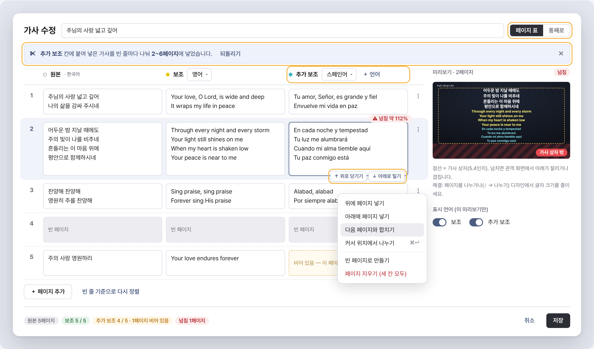
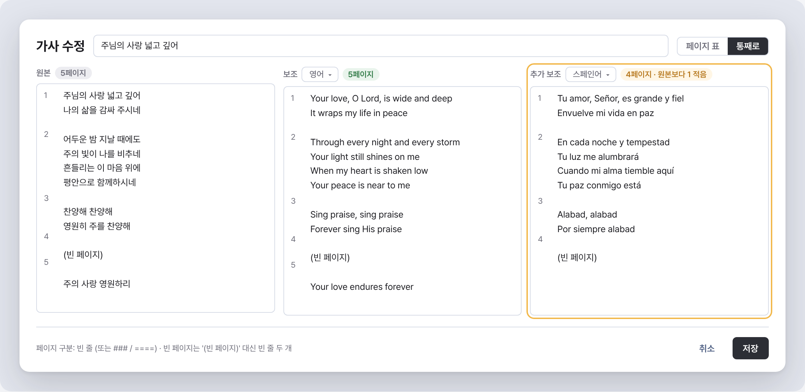
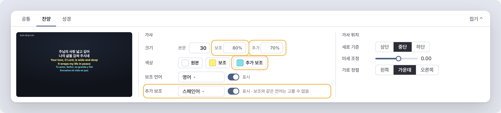
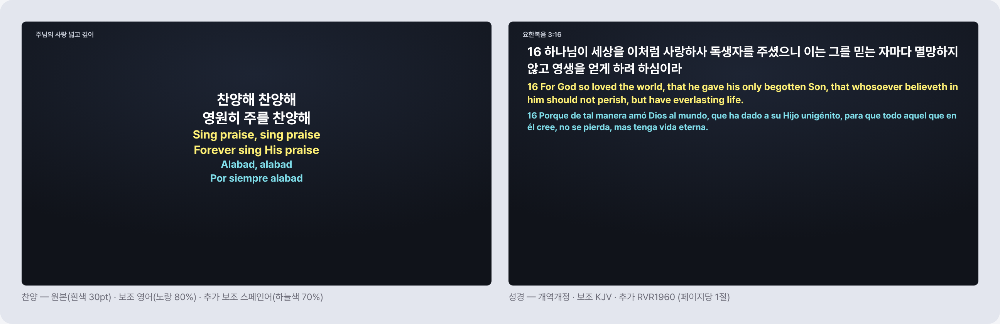
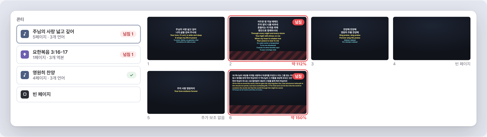
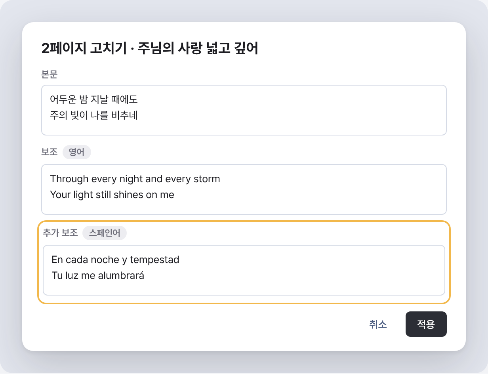

# 기획서 — 관객 화면 3개 언어 동시 표시 (찬양 · 성경)

- 작성일: 2026-10-29
- 상태: **구현 완료(1~6단계)** — macOS·Windows 발표 창은 리눅스에서 컴파일할 수 없어 PR CI 로 확인한다
- 화면 목업: [`mockup.html`](mockup.html) (브라우저로 열기) · PNG 는 [`screens/`](screens)

---

## 0. 한눈에 보기

| 항목 | 내용 |
|---|---|
| 목표 | 관객 화면에 **원본 · 보조 · 추가 보조** 3개 언어를 함께 띄운다. 언어마다 색·크기가 따로다 |
| 범위 | 찬양 가사 + 성경 본문(추가 역본) |
| 표시 위치 | **관객 화면만** (미리보기 · macOS/Windows 발표 창 · PPTX). 싱어 창·휴대폰 싱어/리모컨에는 추가 보조를 보내지 않는다 |
| 편집 | 가사 수정 창을 **좌(원본) · 가운데(보조) · 우(추가 보조)** 의 **페이지 표**로 바꾼다. 한 행 = 한 장 |
| 넘침 | **A안 — 경고만.** 자동 축소는 하지 않는다 |
| 기본값 | 추가 보조/추가 역본 = '없음'. 업데이트해도 지금 화면이 그대로다 |

### 사용자 확정 사항 (2026-10-29)
1. 성경도 찬양과 같이 3개(본문 + 보조 역본 + 추가 역본)를 보여 준다
2. 넘침 대응은 A안(경고만)
3. 설교자(발표 보기)·싱어 화면은 기본 언어만이면 충분 — 추가 보조는 관객 화면 전용
4. (2026-10-29 추가) **설교자 화면은 원본만** 보인다 — 보조·추가 보조는 투명하게 그려 자리만 차지한다(영역 확대 좌표가 관객 화면과 같게)

---

## 1. 화면 설계

### ① 가사 수정 — 페이지 표 (기본 보기)


- **한 행 = 관객 화면 한 장.** 행 높이는 그 행에서 가장 긴 칸에 맞춰서 세 칸이 늘 나란하다 → "같은 행끼리 같은 페이지"가 눈으로 바로 보인다
- 열 머리: `원본 · 한국어` / `보조 [언어▼]` / `추가 보조 [언어▼] ＋언어`. 언어 드롭다운은 지금처럼 `song_translations` 에 있는 언어와 새로 추가한 언어
- **붙여 넣기 자동 나누기**: 칸에 빈 줄이 든 긴 가사를 붙여 넣으면 빈 줄마다 그 아래 행들로 나눠 넣고 배너로 알린다(되돌리기 가능). 한 언어 전체를 한 번에 넣는 흐름이다
- 칸 도구(칸에 포커스가 있을 때): **↑ 위로 당기기 / ↓ 아래로 밀기** — 그 언어만 한 페이지씩 옮긴다. 번역이 한 장씩 어긋났을 때 고치는 기능이다
- 행 메뉴(⋮): 위/아래에 페이지 넣기 · 다음 페이지와 합치기 · 커서 위치에서 나누기(⌘/Ctrl+Enter) · 빈 페이지로 만들기 · 페이지 지우기(세 칸 모두)
- 상태 표시: 빈 칸(점선·연한 주황 "비어 있음"), 행 넘침 배지(`넘침 약 112%`), 아래 요약 줄(언어별 페이지 수 · 비어 있는 페이지 · 넘침 수)
- 오른쪽 미리보기: 고른 행을 **관객 화면과 같은 렌더러**(`SlideRenderView`)로 그린다. 가사 상자(5.4인치)를 점선으로, 넘친 부분을 빗금으로 보여 준다
- 창 폭: 지금 620 → 약 1240 (데스크톱 전용이라 문제없음). 화면이 좁으면 미리보기 칸을 숨긴다

### ② 가사 수정 — 통째로 (붙여 넣기용)


- 지금 방식 그대로 언어별 큰 입력칸 3개. 빈 줄 = 페이지 구분, `###`/`====` 허용(`normalizeEditableLyrics` 그대로)
- 왼쪽 숫자 = 그 칸 기준 페이지 번호. 칸 머리에 페이지 수와 "원본보다 1 적음" 같은 경고
- 두 보기는 **저장 형식이 같아서**(빈 줄 = 페이지) 오가도 손실이 없다. 마지막으로 쓴 보기를 기억한다

### ③ 디자인 리본 — 찬양 탭


- '가사' 묶음에 추가: 크기 `보조 %`·`추가 %`, 색상 `추가 보조`, 줄 `추가 보조 [언어▼] ◉표시`
- 크기는 **본문 대비 %** (기본 보조 80% = 지금 규칙 `본문 × 0.8`, 추가 70%) → 본문 크기를 바꾸면 같이 따라간다
- 보조와 같은 언어는 추가 보조에서 고를 수 없다
- 색·표시 스위치는 지금 보조처럼 **찬양·성경 공통 값**(한쪽 탭에서 바꾸면 같이 바뀐다)

### ④ 디자인 리본 — 성경 탭 + 성경 검색 패널


- '본문' 묶음에 추가: 크기 `보조 %`·`추가 %`(성경 따로), 색상 `보조`·`추가`(찬양과 공통 — 표시), 줄 `추가 역본 [역본▼] ◉표시`
- 66권이 아닌 역본은 고를 수는 있지만 담을 때 그 역본 본문 없이 담는다(지금 보조 역본과 같은 규칙, `mapBookName`)
- 성경 검색 패널: 역본 3개가 켜져 있고 페이지당 절 수가 2 이상이면 **"페이지당 1절 권장 [1절로 바꾸기]"** 배너. '콘티에 담기' 버튼에 넘침 여부를 미리 보여 준다

### ⑤ 관객 화면


- 한 가사 상자 안에 **원본 → 보조 → 추가 보조** 순서로 쌓는다(지금 보조 줄을 붙이는 방식에 한 줄 더)
- 끈 언어나 빈 칸은 자리도 차지하지 않는다
- 미리보기 · macOS 발표 창 · Windows 발표 창 · PPTX 네 곳이 같은 배치다(좌표계 540pt 기준 그대로)

### ⑥ 넘침 경고 (A안)


- 슬라이드 썸네일: 넘친 페이지에 빨간 테두리 + `넘침` 배지 + 대략 비율(`약 112%`)
- 콘티 항목: `넘침 N` 칩. 3개 언어 항목엔 `3개 언어`/`3개 역본` 표시
- 측정은 Flutter 쪽 한 곳(`TextPainter`, 미리보기와 같은 글꼴·크기·줄 높이)에서만 한다. 발표 창·PPTX 의 실제 줄바꿈과는 약간 다를 수 있으므로 **"약"** 으로 표시한다
- 발표는 막지 않는다(경고만)

### ⑦ 슬라이드 한 장 고치기


- `_SlideQuickEditDialog` 에 `추가 보조` 칸 추가. 칸 이름 옆에 지금 언어 이름
- 성경 페이지에서도 같은 창으로 추가 역본 본문을 고칠 수 있다

### ⑧ 싱어 창 · 휴대폰 — 바뀌지 않음


- `SingerViewData` 에 추가 보조 칸을 **만들지 않는다**. 싱어 창(macOS·Windows)·휴대폰 페이지(`singerPageHtml`) 코드는 손대지 않는다
- 발표 보기(설교자 화면)의 현재·다음 슬라이드와 썸네일은 **원본만** 보인다(사용자 결정). 보조 줄은 투명하게 그려 자리를 지키므로 원본 위치·영역 확대 좌표는 관객 화면과 같다. 넘침 배지는 관객 화면 기준으로 뜬다

---

## 2. 데이터 설계

### 2-1. 원칙: "고정 3번째 칸" 추가
지금은 곡을 콘티에 담는 순간 고른 언어 가사를 `englishLyrics` 칸에 **확정해 넣고**(`_withSubLyrics`), 렌더러는 그 칸만 그린다. 같은 방식으로 **`extra` 칸 하나**를 더 만든다.

- `List<String>` 으로 일반화하지 않는 이유: JSON 키·DB 칸·네이티브 2곳·Python 의 기존 `english_*` 키를 모두 바꿔야 하고 예전 설정·콘티와 호환이 깨진다. 요구가 "3개까지"이므로 고정 칸이 비용 대비 낫다
- 대가: 4번째 언어가 필요해지면 다시 손봐야 한다

### 2-2. 곡 DB — 바꾸지 않는다
- 언어별 가사는 이미 `song_translations(song_title, language, lyrics)` 에 개수 제한 없이 저장된다('영어'만 `praise_songs.english_lyrics`)
- 찬양 동기화는 (제목, 언어)마다 따로 맞추므로 **동기화 코드는 고칠 게 없다**

### 2-3. 모델

| 대상 | 추가 | 비고 |
|---|---|---|
| `PraiseSong` | `extraLyrics` (선택 인자, 기본 `''`) | DB(`toMap`)에는 안 들어간다 — 콘티 스냅샷 전용. `pairedPages` 를 `(korean, english, extra)` 로 확장 |
| `SongStagingItem` | (곡 안에 담김) | |
| `BibleStagingItem` | `extraText` | 지금 `subText` 옆 |
| `BlankStagingItem` | `extraText` | 슬라이드 한 장 고치기로 생긴 빈 페이지 문구용 |
| `SlidePageData` | `extraText` → JSON `extra_text` | 발표 창으로 가는 페이지 |
| `_SlideInfo` | `extraText` | 9곳에서 생성 |

### 2-4. 스타일 (`ExportStyle` → `export_style.json`)

| 필드 | JSON 키 | 기본값 | 렌더러가 읽나 |
|---|---|---|---|
| `extraLanguage` | `extra_language` | `''`(없음) | 아니오(담을 때 결정) |
| `bibleExtraVersion` | `bible_extra_version` | `''` | 아니오 |
| `includeExtraLyrics` | `include_extra_lyrics` | `true` | **예** |
| `extraTextColor` | `extra_text_color` | `#80DEEA` | **예** |
| `subFontRatio` / `extraFontRatio` | `sub_font_ratio` / `extra_font_ratio` | 0.8 / 0.7 | 아니오 |
| `bibleSubFontRatio` / `bibleExtraFontRatio` | `bible_sub_font_ratio` / `bible_extra_font_ratio` | 0.8 / 0.7 | 아니오 |
| (보낼 때 계산) | `english_font_size`, `extra_font_size` | 본문 × 비율 | **예** |

- **크기는 Dart 가 pt 로 계산해 페이지 style JSON 에 넣는다.** 네이티브 두 곳은 `extra_font_size` 만 새로 읽으면 된다
- 설교 페이지가 정한 `english_font_size`(부제 크기)는 지금처럼 `withBackground()` 가 마지막에 덮어쓴다
- PPTX 는 `ppt_tool.py` `_style_for_item` 한 곳에서 같은 규칙(본문 × 비율, 설교 덮어쓰기 우선)으로 계산한다

### 2-5. 콘티 저장 — DB version 17 → 18

```sql
ALTER TABLE worship_conti_items ADD COLUMN song_extra_lyrics TEXT;
ALTER TABLE worship_conti_items ADD COLUMN bible_extra_text TEXT;
ALTER TABLE worship_conti_items ADD COLUMN blank_extra_text TEXT;
```
- 올리기 전 자동 백업(`backupBeforeUpgrade`)이 그대로 돈다(`worship_slides.db.v17.bak`)
- `.wsconti`·클라우드 콘티는 DB 행을 그대로 담으므로 새 칸이 자동으로 실린다

### 2-6. 흐름

```
[곡 편집]  원본 + 언어별 가사 ─▶ praise_songs / song_translations   (변경 없음)
                                  │
[콘티 담기] _withSubLyrics ───────┼─ subLanguage   ─▶ englishLyrics
                                  └─ extraLanguage ─▶ extraLyrics      (NEW)
[성경 담기] 본문 / bibleSubVersion ─▶ subText / bibleExtraVersion ─▶ extraText (NEW)
                                  │
[슬라이드]  _allSlides ─▶ _SlideInfo(main, english, extra)
                                  │
         ┌────────────────────────┼─────────────────────────┐
   미리보기(Flutter)   발표 창 JSON(extra_text)        PPTX payload(extra_lyrics / extra_text)
                       ├ macOS WKWebView               └ ppt_tool.py
                       └ Windows GDI
   싱어 JSON(SingerViewData) ─ extra 없음 (변경 없음)
```

- 리본에서 언어를 바꾸면 `_reapplySubLanguage` 가 담아 둔 곡의 **보조와 추가 보조를 둘 다** 다시 입힌다(나눈·복사한 항목은 원본 가사가 같은 페이지를 찾아 입히는 지금 규칙 그대로)
- 성경은 지금도 역본을 바꿔도 담아 둔 절을 다시 입히지 않는다 → 추가 역본도 같게 둔다(담을 때 결정)

---

## 3. 수정 범위

| 층 | 파일 | 변경 |
|---|---|---|
| 모델 | `praise_song.dart` | `extraLyrics`, `pairedPages` 3개짜리 (사용처 약 12곳) |
| 모델 | `staging_item.dart`, `slide_page_data.dart` | `extraText` |
| 스타일 | `export_style.dart`, `export_style_store.dart` | 2-4 표의 필드 |
| DB | `praise_database.dart`, `worship_conti_repository.dart` | v18, 저장·불러오기·`portableItemRow` |
| 미리보기 | `slide_render_view.dart` | 보조 `TextSpan` 뒤에 추가 `TextSpan` |
| macOS | `MainFlutterWindow.swift` | `.extra-text` div + CSS (싱어 쪽은 손대지 않음) |
| Windows | `presentation_channel.cpp` | 추가 블록 측정·그리기 (`english` 블록과 같은 방식) |
| PPTX | `ppt_tool.py` | 곡·성경·빈 페이지에 추가 문단, `_style_for_item` 크기 계산 |
| Python 브리지 | `python_bridge.dart` | payload 에 `extra_lyrics` / `extra_text` |
| 오버레이 | `lyrics_overlay_renderer.dart` | 배경 영상 위 가사 PNG 에 추가 줄 |
| 헌금송 | `offering_dialog.dart` | 띠 높이 계산의 줄 수에 추가 줄 포함 |
| UI | `praise_home_page.dart` | 가사 수정 창(페이지 표), 한 장 고치기, 리본 2탭, 성경 패널 배너, 넘침 배지 |
| 측정 | 새 파일 `slide_overflow.dart` | `TextPainter` 로 가사 상자 높이 대비 비율 |

**바꾸지 않는 곳**: `praise_songs` 스키마, 찬양 동기화(`song_sync_repository.dart`·`sync_snapshot.dart`), 싱어 창 2곳, `singer_web_server.dart`, PPT 가져오기(`is_sub_line`)

---

## 4. 넘침 측정 (A안)

- 가사 상자 높이 = 5.4인치 = **약 389pt** (`top 0.6in`, 고정)
- 기본값(본문 30pt·줄 높이 1.25, 보조 24pt·1.3, 추가 21pt·1.3)으로 언어마다 줄 수가 같을 때 대략:

| 언어별 줄 수 | 높이(약) | 결과 |
|---|---|---|
| 2줄 | 약 192pt | 여유 |
| 3줄 | 약 288pt | 들어감 |
| 4줄 | 약 384pt | **경계** (가로로 감기는 줄이 하나만 있어도 넘침) |
| 5줄 | 약 480pt | 넘침 |

- 측정 함수 하나(`measureLyricsOverflow(page, style)`)를 미리보기 렌더러와 같은 TextStyle 로 만든다. 썸네일·콘티 항목·가사 수정 창·성경 패널이 같이 쓴다
- 결과는 페이지 글자+스타일 해시로 캐시한다(썸네일 수백 장에서 다시 재지 않게)
- 자동 축소(B안)를 하지 않는 이유: GDI·HTML·PPTX 가 각각 다르게 줄여서 4곳이 어긋난다

---

## 5. 호환성

| 상황 | 결과 |
|---|---|
| 업데이트 직후 | 추가 언어 '없음' → 화면 변화 없음 |
| 예전 `export_style.json` | 새 키가 없으면 기본값 → 변화 없음 |
| 옛 버전 앱이 새 `.wsconti`·클라우드 콘티를 받음 | 모르는 칸은 버림(`receivableItemColumns`) → 2개 언어로 열림 |
| 새 앱이 옛 콘티를 엶 | 새 칸 null → 추가 보조 없음 |
| 다른 PC 와 찬양 동기화 | 언어별 가사는 이미 동기화됨 → 변경 없음 |
| 옛 앱으로 되돌리기 | `worship_slides.db.v17.bak` 사용(CLAUDE.md 규칙) |

---

## 6. 기획 검증

### 6-1. 코드로 확인한 전제

| 전제 | 근거 | 확신 |
|---|---|---|
| 언어별 가사 저장은 이미 개수 제한이 없다 | `song_translations`, `_SongEditDialog._subLyrics` 맵 | [높은 확신] |
| 찬양 동기화는 고칠 필요가 없다 | translations 를 (제목, 언어)마다 맞춤 (CLAUDE.md 동기화 절) | [높은 확신] |
| 옛 앱이 새 콘티 파일을 받아도 안 깨진다 | `worship_conti_repository.dart` `_insertImported` 가 모르는 칸을 버림 | [높은 확신] |
| 렌더러는 보조 한 칸만 그린다 | `slide_render_view.dart:336`, `MainFlutterWindow.swift:630`, `presentation_channel.cpp:612-650`, `ppt_tool.py:1817` | [높은 확신] |
| 성경 보조도 같은 `english_text` 칸으로 그린다 | `_allSlides` 에서 `englishText: item.subText` | [높은 확신] |
| 성경은 '페이지당 절 수'로만 나눈다(글 길이를 안 봄) | `bible_text_search.dart` `bibleVersePages` | [높은 확신] |
| 페이지 표와 통째로 보기의 저장 형식이 같다 | 빈 줄 = 페이지(`_parsePages`, `normalizeEditableLyrics`) | [높은 확신] |
| `PraiseSong(...)` 약 13곳, `BibleStagingItem(...)` 약 9곳, `_SlideInfo(...)` 약 9곳(생성자 선언 포함) | grep | [높은 확신] — 빠뜨리면 추가 칸이 사라지므로 전부 점검 대상 |

### 6-2. 기획 중 발견한 것

1. **성경 보조 글자 크기가 지금은 찬양 본문 크기 기준이다.** 렌더러 4곳 모두 `english_font_size` 가 없으면 `font_size`(찬양) × 0.8 을 쓴다. 성경 본문은 `bible_font_size` 를 쓰는데 보조만 찬양 기준인 셈이다. 이번 기획(크기 = 성경 본문 × 비율, Dart 가 계산)으로 바로잡힌다. 두 크기가 같은 기본 설정(30/30)에서는 화면이 바뀌지 않지만 **둘을 다르게 둔 사용자는 성경 보조 크기가 바뀐다**. [높은 확신 — 코드 확인] → 릴리즈 노트에 적는다
2. **4줄 페이지는 3개 언어에서 넘침 경계다**(4절 표). 경고가 자주 뜰 수 있으므로 추가 보조 기본 크기를 70%로 둔다. [보통 확신 – 검증 권장: 실제 글꼴·감김에 따라 다름]
3. **PPT 가져오기는 2개 언어만 나눈다.** `is_sub_line` 은 한글 유무·글자 색으로 나누므로 영어·스페인어가 한 PPT 에 있으면 둘 다 보조로 간다. 이번 범위에서 빼고, 추가 언어는 "언어를 골라 폴더 가져오기"(제목 기준 가사만 붙이기)나 편집 창으로 넣는다. [보통 확신 – 실제 PPT 로 확인 필요]
4. **헌금송 띠 위치**는 가사 줄 수로 상자 높이를 어림한다(`offering_dialog.dart:106`). 추가 줄을 안 세면 가사가 띠와 겹친다 → 수정 범위에 넣었다
5. **설교 페이지**는 보조 줄을 부제로 쓴다 → 추가 보조는 설교 페이지에 쓰지 않는다(설교 페이지 다이얼로그 변경 없음)

### 6-3. 남은 확인 사항
- Swift·C++ 발표 창은 이 리눅스 환경에서 컴파일할 수 없다 → PR CI(Build Release)로만 검증된다
- Windows GDI 의 줄 감김이 미리보기와 약간 다를 수 있어 넘침 비율은 "약"으로만 보여 준다
- 성경 추가 역본이 66권이 아닐 때 동작(본문 없이 담김)은 실제 역본 JSON 으로 확인 필요

---

## 7. 테스트 계획

| 테스트 | 내용 |
|---|---|
| `test/multilingual_test.dart` 확장 | 담을 때 보조·추가 보조가 각 칸에 들어가는지, 언어를 바꾸면 둘 다 다시 입혀지는지, 보조=추가 같은 언어 방지 |
| 새 `test/lyrics_page_grid_test.dart` | 페이지 표 ↔ 저장 형식 왕복, 붙여 넣기 자동 나누기, 칸 위로/아래로 옮기기, 행 합치기·나누기, 빈 페이지 보존 |
| `test/move_pages_test.dart` 확장 | `itemsFromPages`·나누기·복사 때 추가 칸이 따라가는지 |
| 새 `test/slide_overflow_test.dart` | 3/4/5줄 경계, 끈 언어는 높이에서 빠지는지 |
| DB | v17 → v18 마이그레이션, 콘티 저장·불러오기·`.wsconti` 왕복(`conti_file_test.dart`) |
| Python 새 `python/test_export_extra.py` | PPTX 에 3번째 문단·색·크기, 설교 덮어쓰기 우선, 성경 크기 = 성경 본문 × 비율 |
| 위젯 | 리본 추가 보조 줄, 가사 수정 창 두 보기 전환 |
| CI | macOS·Windows 빌드 (네이티브 렌더러) |

---

## 8. 진행 순서

| 단계 | 내용 | 확인 |
|---|---|---|
| 1 | 모델·스타일·DB v18·저장/불러오기 | 단위 테스트 |
| 2 | 미리보기 렌더러 + 넘침 측정 + 썸네일 배지 | 위젯 테스트, 스크린샷 |
| 3 | 가사 수정 창(페이지 표·통째로)·한 장 고치기 | 위젯 테스트 |
| 4 | 리본 찬양·성경 탭, 성경 패널 배너, `_reapplySubLanguage` | 위젯 테스트 |
| 5 | macOS·Windows 발표 창, 배경 영상 오버레이, PPTX, 헌금송 | Python self-check, CI 빌드 |
| 6 | CLAUDE.md 갱신(다국어 절·DB version 18·렌더러 4곳 규칙) | 리뷰 |
